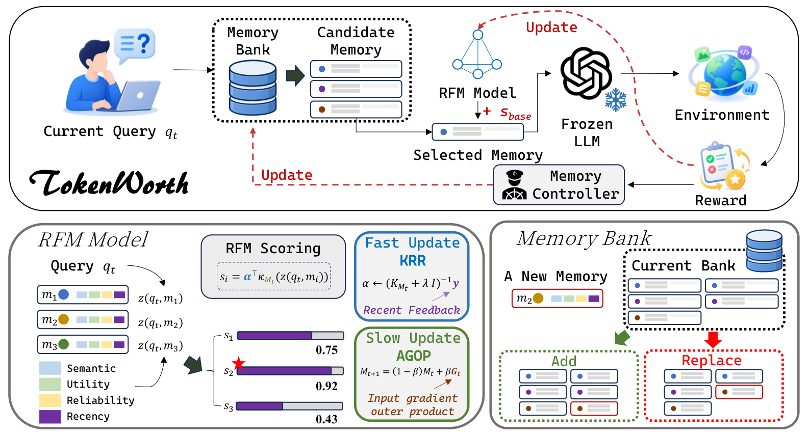
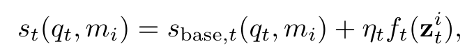

<div align="center">

# TokenWorth

### Every Token Counts:<br>Online Memory Worth for Resource-Constrained Lifelong Agents

Guannan Lai · Zi-Yang Bai · Jun-Peng Jiang · Han-Jia Ye<br>
Nanjing University

**[NeurIPS 2026 Workshop on Towards Test-Time Continual Learning Agents](https://openreview.net/forum?id=PM9T7txQUG)**

**Learn which experiences are worth retrieving, retaining, and reusing.**

[](https://openreview.net/forum?id=PM9T7txQUG) [](https://github.com/AIGNLAI/TokenWorth/actions/workflows/tests.yml) [](#benchmarks) [](#benchmarks)

[Overview](#overview) · [Quick Start](#quick-start) · [Benchmarks](#benchmarks) · [Method](#method) · [Citation](#citation)

</div>

## Overview

Lifelong agents learn from experience while operating under limited generation,
interaction, and memory budgets. A relevant memory can still be unhelpful:
what matters is whether it improves execution under those constraints.

**TokenWorth** is a lightweight online memory framework that learns
query-dependent memory worth from execution feedback. It combines an
interpretable base scorer with a residual Recursive Feature Machine (RFM),
and uses the same learned value for retrieval and bounded memory management.
The agent's backbone stays frozen throughout the task stream.

<p align="center">
  
  <br>
  <sub>Figure 2. Overview of TokenWorth.</sub>
</p>

- **Worth-aware retrieval.** Rank recalled experiences by learned usefulness for the current query.
- **Two-timescale adaptation.** Update residual predictions with KRR and adapt feature geometry more slowly with AGOP.
- **Bounded memory management.** Use learned worth to guide admission, replacement, and eviction.
- **Online learning.** Evaluate each task before updating memory; TokenWorth uses no auxiliary model calls.

## Quick Start

### 1. Clone and install

```bash
git clone https://github.com/AIGNLAI/TokenWorth.git
cd TokenWorth
```

Choose a benchmark and run its installer. Each creates an independent `.venv`
inside its directory and installs its fixed dependencies and the shared core.
The corresponding Python interpreter must already be available.

```bash
# LifelongAgentBench — Python 3.11
bash LifelongAgentBench/scripts/install.sh

# BigCodeBench — Python 3.10
bash BigCodeBench/scripts/install.sh

# ALFWorld — Python 3.9
bash ALFWorld/scripts/install.sh
```

Set `PYTHON_BIN` to select an interpreter, for example `PYTHON_BIN=python3.11`.
Install only the benchmarks you need.

### 2. Prepare the model and task environment

Use an OpenAI-compatible endpoint. For the local configurations, serve
`Qwen/Qwen2.5-14B-Instruct` with the model name `qwen2.5-14b-instruct`:

```bash
export OPENAI_BASE_URL=http://127.0.0.1:8000/v1
export OPENAI_API_KEY=local
export NO_PROXY=127.0.0.1,localhost
export LIFELONG_AGENT_MODEL_NAME=qwen2.5-14b-instruct
```

Prepare the selected task environment before running:

| Benchmark | Preparation | Guide |
|---|---|---|
| LifelongAgentBench | Included data; Docker for DB/OS; Freebase-compatible SPARQL service for KG | [Setup](LifelongAgentBench/README.md#2-prepare-data-and-task-environments) |
| BigCodeBench | Official Full/Hard data and Docker evaluator image | [Setup](BigCodeBench/README.md#installation) |
| ALFWorld | Official text-game data and `ALFWORLD_DATA_ROOT` | [Setup](ALFWorld/README.md#installation) |

Data downloaders verify the pinned checksums. Benchmark environments and
model inference run separately; the installers set up the evaluation clients.
Dataset paths in the environment templates are relative to the corresponding
benchmark directory; you can override them for your own data location.

### 3. Run TokenWorth

From the repository root, choose a prepared benchmark:

**LifelongAgentBench — DB, OS, and KG**

```bash
(cd LifelongAgentBench && .venv/bin/python scripts/run_experiments.py --jobs 1 \
  configs/experiments/db/TokenWorth.yaml \
  configs/experiments/os_interaction/TokenWorth.yaml \
  configs/experiments/knowledge_graph/TokenWorth.yaml)
```

**BigCodeBench**

```bash
(cd BigCodeBench && .venv/bin/python scripts/run_suite.py local --method tokenworth)
```

**ALFWorld**

```bash
(cd ALFWorld && .venv/bin/python scripts/run_suite.py --method tokenworth)
```

Each benchmark writes trajectories, usage, checkpoints, and metrics to its own
`outputs/` directory. The benchmark guides cover smoke subsets, model options,
resume, baselines, and reporting.

## Benchmarks

Three parallel benchmark suites cover five task environments:

| Suite | Tasks | Stream | Python | Documentation |
|---|---|---|---|---|
| **LifelongAgentBench** | Database interaction, shell tasks, knowledge-graph reasoning | DB: 500 · OS: 500 · KG: 150 | 3.11 | [Guide](LifelongAgentBench/README.md) |
| **BigCodeBench** | Python programming | Full v0.1.4: 1,140; Hard subset: 148 | 3.10 | [Guide](BigCodeBench/README.md) |
| **ALFWorld** | Interactive text-based household tasks | Train: 300 · Seen: 140 · Unseen: 134 | 3.9 | [Guide](ALFWorld/README.md) |

BigCodeBench processes Full minus Hard before Hard. ALFWorld processes train,
seen, and unseen phases sequentially with online updates after every episode.
See [benchmark protocols](docs/BENCHMARK_PROTOCOLS.md) for task order, memory
limits, generation budgets, and evaluation settings.

## Method

For the current query and a candidate memory, TokenWorth combines a base score
with a residual correction:

<p align="center">
  
</p>

1. **Recall and rank.** BM25 recalls candidate experiences. The base scorer
   uses similarity, utility, reliability, and recency; the residual learner
   models query-specific deviations.
2. **Execute and evaluate.** Inject the highest-ranked memory into a frozen
   agent, execute the task, and obtain an external outcome.
3. **Learn from feedback.** Supervise the injected memory. Fast KRR updates
   track residuals; slower AGOP updates adapt retrieval geometry.
4. **Manage the bank.** Admit verified successful experiences and use the same
   learned worth to decide which memories to retain under a capacity limit.

See the [algorithm documentation](docs/TOKENWORTH.md) for representations,
objectives, feedback targets, update schedules, and memory management.

## Evaluation

Each comparison uses the same task stream, backbone, evaluator, and resource
limits within its benchmark setting. Baselines are adapted to the benchmark
interfaces. Token usage includes execution and auxiliary calls, and reports
separate incomplete or invalid runs from completed comparisons.

Runs record model, configuration, data, source, dependency, and evaluator
identity. Resume continues from committed task boundaries. Retain the exact
model revision and external dataset/service snapshot when collecting results.
Details are in the [benchmark protocols](docs/BENCHMARK_PROTOCOLS.md).

## Repository Structure

```text
TokenWorth/
├── LifelongAgentBench/     # DB / OS / KG: code, configs, data, scripts, tests
├── BigCodeBench/           # Coding: configs, runners, Docker evaluator, tests
├── ALFWorld/               # Text games: configs, continual runner, tests
├── tokenworth_core/        # Shared online memory learner
├── assets/                 # Figures and equation from the paper
├── docs/                   # Algorithm and evaluation protocols
└── .github/workflows/      # Independent benchmark CI jobs
```

## Citation

If you use TokenWorth, cite:

```bibtex
@inproceedings{lai2026every,
  title = {Every Token Counts: Online Memory Worth for Resource-Constrained Lifelong Agents},
  author = {Guannan Lai and Zi-Yang Bai and Jun-Peng Jiang and Han-Jia Ye},
  booktitle = {NeurIPS 2026 Workshop on Towards Test-Time Continual Learning Agents},
  year = {2026},
  url = {https://openreview.net/forum?id=PM9T7txQUG}
}
```

## Acknowledgements

The benchmark adapters build on
[LifelongAgentBench](https://github.com/caixd-220529/LifelongAgentBench),
[BigCodeBench](https://github.com/bigcode-project/bigcodebench), and
[ALFWorld](https://github.com/alfworld/alfworld).
BigCodeBench and ALFWorld retain their respective
[Apache-2.0](BigCodeBench/LICENSE) and [MIT](ALFWorld/LICENSE) license notices.

For questions and issues, open a [GitHub issue](https://github.com/AIGNLAI/TokenWorth/issues).
